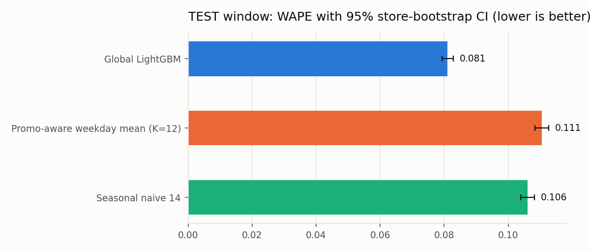
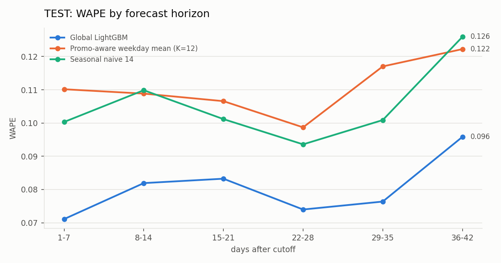
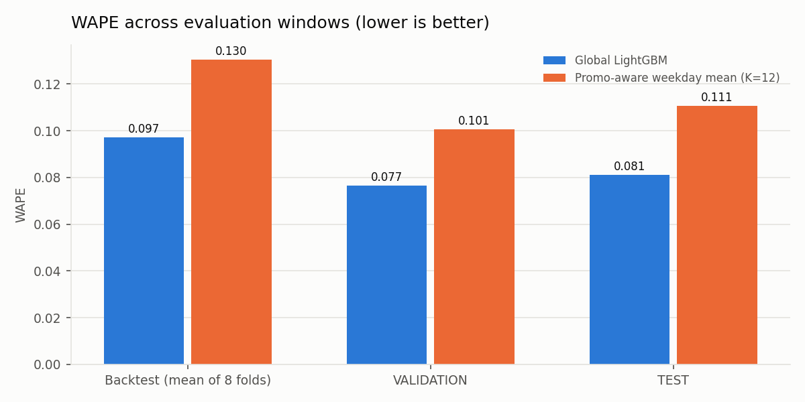
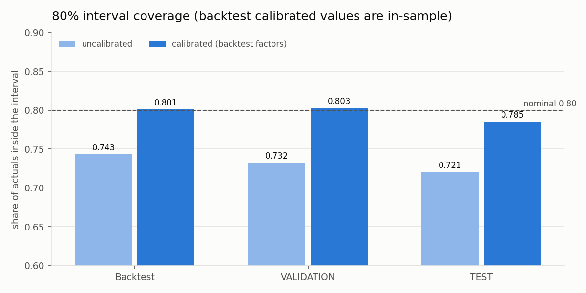

# Retail demand forecasting — Rossmann Store Sales

Forecast daily sales of 1,115 Rossmann drugstores 42 days ahead, with a pre-registered evaluation protocol, honest baselines, a global LightGBM model, calibrated prediction intervals and a promotion analysis that is explicitly an association.

_This README is generated by `scripts/make_readme.py` from `evals/results/*.json`; `tests/test_readme.py` fails if any number here differs from the result files._



## Problem

At a cutoff date, forecast `Sales` for every store for each of the next 42 days using only data up to the cutoff plus information known in advance (calendar, state/school holidays, planned `Promo`, store attributes). Days with `Open = 0` are forecast as 0 and excluded from the metrics; evaluated rows are open days with `Sales > 0`.

## Data

- Source: Rossmann store data from the Kaggle competition [`rossmann-store-sales`](https://www.kaggle.com/competitions/rossmann-store-sales). Credit to Rossmann and Kaggle.
- **The data is not included in this repository** and must not be redistributed. To reproduce: accept the competition rules on Kaggle, download `train.csv` and `store.csv` (e.g. `kaggle competitions download -c rossmann-store-sales`), and set `ROSSMANN_RAW_DIR` to that folder. `test.csv` has no sales and is not used.
- 1,017,209 store-day rows, 1,115 stores, 2013-01-01 to 2015-07-31 (942 days). 33,121 store-days have no row (3.2%); up to 180 stores are missing at the same time in July-December 2014. 172,817 rows are closed days. Full audit: [`docs/data_audit.md`](docs/data_audit.md).

## Protocol and leakage rules

Each step's protocol was committed before the corresponding runs: [`docs/forecast_protocol.md`](docs/forecast_protocol.md) (baselines), [`docs/model_protocol.md`](docs/model_protocol.md) (model), [`docs/final_protocol.md`](docs/final_protocol.md) (TEST). Deviations are dated amendments.

- Windows: TRAIN 2013-01-01..2015-05-08, VALIDATION 2015-05-09..2015-06-19, TEST 2015-06-20..2015-07-31. 8 rolling-origin backtest folds (42-day horizons) inside TRAIN; all tuning and selection used the backtest folds only; VALIDATION was used once per step for confirmation; TEST was evaluated once (run record: commit `87681ba`, 40,282 rows, refuses a second run).
- **`Customers` is never used**: it is observed only together with sales, so it is unknown at forecast time. Modelling code reads explicit column lists without it, and tests fail if any module, feature list or script uses it.
- Every feature is computed from data up to its cutoff plus calendar/holiday/promo information up to the end of the horizon (tests move the cutoff and perturb future data to check this).
- Metrics on evaluated rows: RMSPE (competition metric), WAPE = Σ|e|/Σy, MASE vs in-sample seasonal naive (7), Bias = Σ(forecast−actual)/Σy. 95% CIs: store-clustered bootstrap (500 resamples); differences are paired. CIs reflect store sampling, not period-to-period variation.
- Every configuration tried, including dropped ones, is in `evals/results/spec_log.csv`.

## Baselines (backtest: mean over 8 folds)

| Baseline | Config | RMSPE | WAPE | MASE | Bias | VALIDATION WAPE |
|---|---|---|---|---|---|---|
| Seasonal naive 7 | period=7 | 0.371 | 0.240 [0.237, 0.243] | 0.863 | -0.040 | 0.185 |
| Seasonal naive 14 | period=14 | 0.348 | 0.201 [0.199, 0.203] | 0.725 | -0.003 | 0.204 |
| Promo-aware weekday mean | K=12 | 0.237 | 0.130 [0.129, 0.132] | 0.486 | -0.005 | 0.101 |
| Store median × weekday/promo index | L=52 | 0.306 | 0.143 [0.141, 0.145] | 0.536 | -0.004 | 0.127 |
| Per-store ETS (weekly) | m=7 | 0.322 | 0.216 [0.213, 0.218] | 0.777 | -0.028 | 0.162 |

The promo-aware weekday mean was the best baseline in backtest and validation. Details: `evals/results/baselines_backtest.md`.

## Global LightGBM

One direct multi-horizon model: one row per (store, weekly cutoff, target day), horizon 1-42 as a feature, 45 features (calendar, holidays, planned promo flags, Promo2, store attributes, history at the cutoff), target log1p(Sales). Selected on backtest WAPE from a 4-config grid: `num_leaves=63`, `min_child_samples=50` (grid WAPE range 0.0970-0.0990).

| Window | System | RMSPE | WAPE | MASE | Bias |
|---|---|---|---|---|---|
| Backtest (8 folds) | Global LightGBM | 0.211 [0.144, 0.288] | 0.097 [0.096, 0.099] | 0.361 [0.353, 0.369] | -0.017 [-0.019, -0.015] |
| Backtest (8 folds) | Promo-aware weekday mean (K=12) | 0.237 [0.184, 0.305] | 0.130 [0.129, 0.132] | 0.486 [0.476, 0.497] | -0.005 [-0.006, -0.004] |
| VALIDATION | Global LightGBM | 0.107 [0.101, 0.115] | 0.077 [0.076, 0.078] | 0.292 [0.286, 0.299] | -0.011 [-0.013, -0.009] |
| VALIDATION | Promo-aware weekday mean (K=12) | 0.146 [0.135, 0.159] | 0.101 [0.099, 0.102] | 0.382 [0.373, 0.391] | -0.033 [-0.036, -0.031] |

Paired WAPE difference, model − baseline: backtest -0.0333 [-0.0350, -0.0316] (folds 2-5, the Jul-Dec 2014 gap period: -0.0450 [-0.0465, -0.0437]; other folds: -0.0217 [-0.0245, -0.0189]); VALIDATION -0.0240 [-0.0250, -0.0230].

**Ablations** (backtest, paired WAPE difference ablation − full; positive = the removed part helps):

| Ablation | ΔWAPE [95% CI] |
|---|---|
| No history features | +0.0656 [+0.0588, +0.0721] |
| No promo features | +0.0561 [+0.0547, +0.0575] |
| No holiday features | +0.0032 [+0.0028, +0.0034] |
| Horizon feature fixed to 1 | +0.0003 [+0.0001, +0.0005] |

## Test result (evaluated once)

Forecast from cutoff 2015-06-19 for 2015-06-20..2015-07-31, frozen model trained on data through 2015-06-19.

| System | RMSPE | WAPE | MASE | Bias |
|---|---|---|---|---|
| Global LightGBM | 0.117 [0.112, 0.124] | 0.081 [0.079, 0.083] | 0.294 [0.288, 0.302] | 0.015 [0.013, 0.018] |
| Promo-aware weekday mean (K=12) | 0.157 [0.152, 0.163] | 0.111 [0.108, 0.113] | 0.400 [0.391, 0.412] | 0.040 [0.037, 0.043] |
| Seasonal naive 14 | 0.148 [0.141, 0.155] | 0.106 [0.104, 0.108] | 0.386 [0.377, 0.398] | 0.001 [-0.002, 0.005] |

Paired WAPE differences: model − baseline -0.0295 [-0.0307, -0.0281]; model − seasonal naive 14 -0.0250 [-0.0264, -0.0237]; baseline − seasonal naive 14 +0.0045 [+0.0032, +0.0057].

Model WAPE by horizon on TEST: 1-7 days 0.071, 8-14 days 0.082, 15-21 days 0.083, 22-28 days 0.074, 29-35 days 0.076, 36-42 days 0.096. Full breakdowns (horizon, promo, store type, day of week): [`evals/results/final_test.md`](evals/results/final_test.md).





## Prediction intervals (80%)

Quantile models (q10, q90) with the same features. Calibration: split-conformal factors per horizon bucket, fitted on backtest folds only and applied unchanged to VALIDATION and TEST.

| Set | Coverage, uncalibrated | Coverage, calibrated | Relative width, uncalibrated | Relative width, calibrated |
|---|---|---|---|---|
| Backtest (calibrated = in-sample) | 0.743 [0.740, 0.747] | 0.801 [0.797, 0.804] | 0.257 | 0.292 |
| VALIDATION | 0.732 [0.727, 0.738] | 0.803 [0.797, 0.808] | 0.212 | 0.248 |
| TEST | 0.721 [0.714, 0.727] | 0.785 [0.779, 0.791] | 0.230 | 0.266 |

On TEST the calibrated misses are uneven: 0.163 of actuals fall below the interval and 0.052 above it.



## Promotion analysis — association, not causation

Rossmann chose when promotions ran (they alternate by week), so these are adjusted associations. They say nothing about profit, cannibalisation or what would happen under a different promotion schedule.

- Within-store regression (store + weekday + week-of-year fixed effects): promo days have +37.9% higher sales [+37.2%, +38.7%] (store-clustered CI, 632,695 Mon-Fri open days of TRAIN).
- Within-store regression (+ holiday indicators): promo days have +38.0% higher sales [+37.3%, +38.7%] (store-clustered CI, 632,695 Mon-Fri open days of TRAIN).
- Within-store regression (store × weekday fixed effects): promo days have +38.0% higher sales [+37.2%, +38.7%] (store-clustered CI, 632,695 Mon-Fri open days of TRAIN).
- Around promo days (timing pattern, not an effect): the day after a promo day -13.4%, the day before +12.8%.
- In the global model, setting Promo to 1 vs 0 changes predicted sales by a factor of 1.323 [1.317, 1.328] (store-level spread p10-p90: 1.214-1.439).
- Details and per-store-type numbers: [`evals/results/promo_analysis.md`](evals/results/promo_analysis.md).

## Limitations

- **Single test window, single retailer.** TEST is one 42-day summer window (2015-06-20..2015-07-31) from one cutoff; it does not establish performance in other seasons (e.g. Christmas), years, horizons or retailers.
- **20% training-row sample** (fixed seed) for compute reasons, and a **1,500-tree cap**: 3 of 83 early-stopped fits reached it (the final q10 model uses 1500 trees).
- **Back-transform bias:** forecasts are expm1 of a log-scale prediction (roughly a median). Bias is reported everywhere; a smearing correction was tested as a secondary variant and over-forecast on VALIDATION, so it was not adopted.
- **Open flag assumed known** for the forecast days: closed days are forecast as 0 and excluded, so unplanned closures are not evaluated.
- **Data gap:** 180 stores have no rows from July to December 2014; why is not in the data.
- Bootstrap CIs capture store sampling only; fold-to-fold variation in the backtest is much larger.

## Reproduce

```bash
python3 -m venv .venv && .venv/bin/pip install -r requirements.txt
export ROSSMANN_RAW_DIR=/path/to/rossmann-raw
python scripts/prepare_data.py && python scripts/make_windows.py && python scripts/audit_data.py
python scripts/run_baselines.py --stage backtest && python scripts/run_baselines.py --stage validation
for s in features grid ablations quantiles analysis report validation; do python scripts/run_model.py --stage $s; done
python scripts/final_test.py --stage calibrate && python scripts/final_test.py --stage train
python scripts/final_test.py --stage test        # one-shot; refuses a second run
python scripts/make_figures.py && python scripts/make_readme.py
python -m pytest
streamlit run app/app.py
```

If ROS 2 is sourced, prefix commands with `env -u PYTHONPATH`. Scripts cap numerical threads at 1, LightGBM at 2 threads, and run a memory watchdog that exits below 1 GB of available RAM.

## AI assistance

This project was built with Claude Code assisting on code and drafting. The author specified the protocol (windows, leakage rules, metrics, one-shot test) and reviewed every result.
